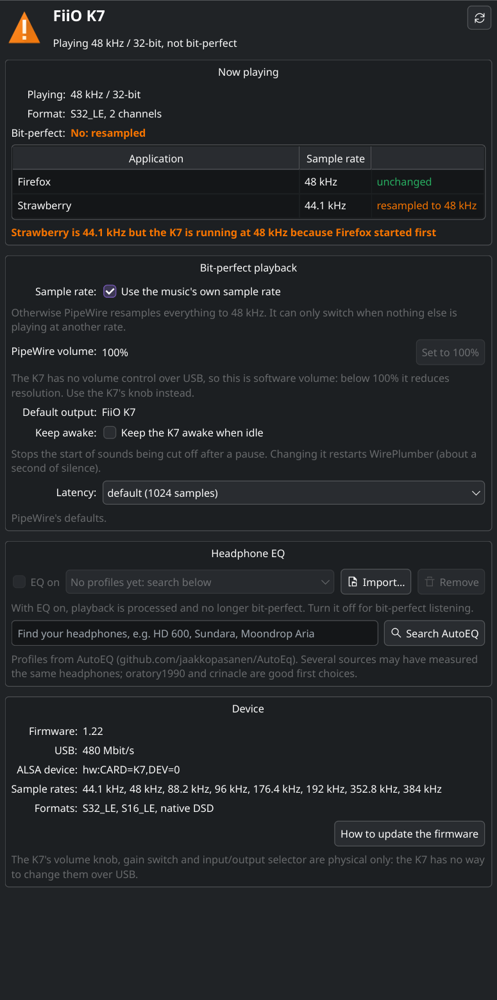

# fiio-k7-linux (k7ctl): FiiO K7 on Linux

[](https://github.com/doodersrage/fiio-k7-linux/actions/workflows/test.yml)

FiiO's software for the K7 DAC/headphone amp is Windows-only. This project gives Linux the parts that matter:

- **Status**: what the K7 is receiving right now (sample rate, bit depth, PCM or DSD), firmware version, connection.
- **Bit-perfect setup**: by default PipeWire resamples *everything* to 48 kHz. `k7ctl` lets it switch the K7 to the
  native rate of what's playing (44.1 kHz up to 384 kHz) and checks that PipeWire's volume isn't throwing away resolution.
- **"Why isn't it bit-perfect?"**: lists every app playing to the K7, marks the ones being resampled, and names the app
  that's holding the K7 at the other rate.
- **Headphone EQ** with profiles for thousands of headphones from [AutoEQ](https://github.com/jaakkopasanen/AutoEq).
- **Keep awake**: stops the start of sounds being cut off after the K7 has been idle.
- **Latency presets** against crackles at high sample rates (or for low-latency gaming).
- **A settings window** (`k7ctl gui`, or "FiiO K7" in your app launcher) and a **system tray icon** with all of the above.
- Output for **Waybar, Polybar** and scripts (JSON); bash, zsh and fish completions; a man page.



## What the K7 does and doesn't expose over USB

The K7 is a standard USB Audio Class 2 device, so **sound works on Linux with no driver**. All formats work:
PCM 16/32-bit at 44.1 to 384 kHz, and native DSD up to DSD256.

Over USB it has only two things: the audio stream and a firmware-update (DFU) interface.
**It has no volume, gain, mute or input/output controls over USB.** The volume knob, gain switch and
input/output selector are physical only, so no Linux (or Windows) software can change them. Windows needs FiiO's
driver for ASIO; Linux's USB audio driver and PipeWire already cover that.

## Install

Packages are attached to each [release](https://github.com/doodersrage/fiio-k7-linux/releases/latest).

### Arch Linux and derivatives (EndeavourOS, Manjaro, CachyOS)

```sh
sudo pacman -S --needed python-pyqt6                 # for the tray icon
sudo pacman -U ./k7ctl-*-any.pkg.tar.zst
```

Or build it from source:

```sh
sudo pacman -S --needed base-devel git python-pyqt6
git clone https://github.com/doodersrage/fiio-k7-linux
cd fiio-k7-linux
makepkg -si
```

### Debian, Ubuntu, Linux Mint, Pop!_OS

```sh
sudo apt install ./k7ctl_*_all.deb
```

### Fedora

```sh
sudo dnf install ./k7ctl-*.noarch.rpm
```

### Anything else

```sh
pipx install "git+https://github.com/doodersrage/fiio-k7-linux"                  # command line only
pipx install "k7ctl[tray] @ git+https://github.com/doodersrage/fiio-k7-linux"   # with the tray icon
```

Needs Python 3.9+, PipeWire with WirePlumber (the default on current Fedora, Ubuntu, Debian, Arch), and
for the window and tray icon PyQt6 or PySide6. The EQ needs a systemd user session (standard on all of the above).
No root access or udev rules needed: everything is read from `/proc` and `/sys` or done through PipeWire as your user.

## Quick start

```sh
k7ctl            # status
k7ctl setup      # bit-perfect setup: native sample rates, K7 as default output, PipeWire volume 100%
k7ctl gui        # the window (also "FiiO K7" in your app launcher)
k7ctl tray       # tray icon: click it to open the window; "Start at login" is in its menu
```

> **Turn the K7's knob down before `k7ctl setup`.** If PipeWire's volume for the K7 was below 100%, the setup raises it to 100%,
> so the same knob position will be louder.

## Commands

| Command | What it does |
|---|---|
| `k7ctl status` | What's playing, which apps, what's resampled and why, firmware, volume, rates, latency, EQ. `--watch` to follow changes; `--format json\|waybar\|short`. |
| `k7ctl rates enable` / `disable` | Let PipeWire run at the music's own rate (or go back to 48 kHz only). Applied immediately. |
| `k7ctl volume-max` | Set PipeWire's volume for the K7 to 100% and unmute. |
| `k7ctl setup` | `rates enable`, make the K7 the default output, and `volume-max` (asks first; `-y` to skip asking). |
| `k7ctl keepawake on` / `off` | Stop the K7 being suspended when idle. Restarts WirePlumber (about a second of silence). |
| `k7ctl latency [default\|stable\|low-latency]` | Buffer size presets. Without a preset, shows the current one. |
| `k7ctl eq search <headphone>` | Search AutoEQ's headphone profiles. |
| `k7ctl eq get "<headphone>" [--source …] [--on]` | Download a profile (and turn EQ on with it). |
| `k7ctl eq import <file>` | Import an Equalizer APO / `ParametricEQ.txt` file. |
| `k7ctl eq on [profile]` / `off` | Turn the EQ on or off. `eq list`, `eq status`, `eq remove` manage profiles. |
| `k7ctl firmware` | Installed firmware version and how to update it. |
| `k7ctl gui` | The settings window. |
| `k7ctl tray` | System tray icon; click it to open the window. Without a system tray, opens the window. |

See `man k7ctl` for everything.

## Is it bit-perfect?

```
$ k7ctl
FiiO K7  (ALSA card 1, hw:CARD=K7,DEV=0)
  Firmware:     1.22
  USB:          480 Mbit/s
  Playing:      48 kHz / 32-bit
  Format:       S32_LE, 2 ch
  Stream:       Firefox, 48 kHz
  Stream:       Strawberry, 44.1 kHz  -> resampled to 48 kHz
  PW volume:    100%
  PW rates:     44.1 kHz, 48 kHz, 88.2 kHz, 96 kHz, 176.4 kHz, 192 kHz, 352.8 kHz, 384 kHz
  Latency:      default (1024 samples)
  Keep awake:   off
  EQ:           off
  Bit-perfect:  no

Tip: Strawberry is 44.1 kHz but the K7 is running at 48 kHz because Firefox started first
```

- **PipeWire can only switch rates when nothing else is playing.** Here a browser tab was already playing at 48 kHz, so
  the 44.1 kHz music is resampled. Pause the other app and restart the track, and the K7 switches to 44.1 kHz.
- Apps that are open but silent (a paused video tab) don't block rate switching; only streams actually playing do.
- The allowed-rates setting is PipeWire-wide. Other outputs that can't do the chosen rate get resampled by PipeWire as
  before, so nothing breaks.
- **Volume**: the K7 has no hardware volume over USB, so PipeWire's volume slider for it is software volume.
  Anything under 100% reduces the signal digitally. Leave it at 100% and use the knob.
- "32-bit" is the container PipeWire sends; a 16- or 24-bit file arrives unchanged inside it.

## Headphone EQ

```sh
k7ctl eq search hd 600
k7ctl eq get "Sennheiser HD 600" --source oratory1990 --on
k7ctl eq off
```

Or in the window: type your headphones in **Headphone EQ**, pick a result and **Download and turn EQ on**.

Turning the EQ on adds an output called **FiiO K7 + EQ** and makes it the default; it processes the sound and sends it
to the K7. Turning it off makes the K7 the default again. With EQ on, playback is processed, so it is **not
bit-perfect**; `k7ctl status` says so.

- Profiles come from AutoEQ, which has measurements of thousands of headphones and IEMs, often from several sources
  (oratory1990 and crinacle are good first choices). Any parametric EQ in the Equalizer APO format works with
  `k7ctl eq import`.
- The profile's preamp is applied, so boosted frequencies don't clip. If a file has no preamp, k7ctl cuts by the
  largest boost.
- It runs as a systemd user service, `k7ctl-eq.service`, which starts with PipeWire at login while EQ is on.
  Logs: `journalctl --user -u k7ctl-eq`.
- Profiles are kept in `~/.local/share/k7ctl/eq/`.

## Keep awake

WirePlumber closes an idle output after about 5 seconds. Reopening it takes a moment, so the start of the next sound
(a notification, the first notes of a track) can be cut off or pop. `k7ctl keepawake on` turns that off for the K7
only. It's applied by restarting WirePlumber; k7ctl keeps the K7 as the default output across the restart.

## Latency

| Preset | Buffer | For |
|---|---|---|
| `default` | 1024 samples | PipeWire's normal setting |
| `stable` | 2048 (1024 to 8192) | crackles or dropouts, especially at 352.8 and 384 kHz |
| `low-latency` | 256 (64 to 512) | games, calls, music software; may crackle at high rates |

Applied immediately; saved in `~/.config/pipewire/pipewire.conf.d/51-k7ctl-latency.conf`.

## Status bars

**Waybar**: copy the module from [`contrib/waybar/config.jsonc`](contrib/waybar/config.jsonc) (and optionally the CSS from
[`contrib/waybar/style.css`](contrib/waybar/style.css)). It shows e.g. `🎧 44.1k`, `🎧 48k*` when something is resampled,
`🎧 44.1k EQ` with EQ on, and the full status as a tooltip. CSS classes: `playing`, `idle`, `resampled`, `eq`, `disconnected`.

**Polybar**: see [`contrib/polybar.ini`](contrib/polybar.ini). **KDE**: add a "Command Output" widget running
`k7ctl status --format short`. Packages install these examples in `/usr/share/doc/k7ctl/`.

## DSD

PipeWire plays PCM. For native DSD (DSF/DFF files sent to the DAC as DSD, not converted):

- **`pw-dsdplay file.dsf`** (comes with PipeWire) plays a DSD file natively through PipeWire. *Not yet tested with the K7.*
- **MPD**: send straight to the DAC with ALSA:

  ```
  audio_output {
      type            "alsa"
      name            "FiiO K7 (direct, native DSD)"
      device          "hw:CARD=K7,DEV=0"
      dop             "no"
      mixer_type      "none"
      auto_resample   "no"
      auto_format     "no"
      auto_channels   "no"
  }
  ```

  `hw:` access is exclusive: if PipeWire is using the K7 at that moment, MPD reports "Device or resource busy". PipeWire
  releases an idle device after a few seconds (unless keep-awake is on: turn it off if you use `hw:` output a lot).
- Other players with a direct ALSA/"exclusive" output (Strawberry, DeaDBeeF, Audacious with the ALSA plugin) work the same
  way with device `hw:CARD=K7,DEV=0`.

`k7ctl status` shows e.g. `DSD64 (2.822 MHz, native)` when DSD is playing.

## Firmware updates

k7ctl shows the installed version but **does not flash firmware**. FiiO's update format isn't documented, and a failed
flash can leave the DAC unusable. To update, run FiiO's Windows updater, either on a Windows PC or in a Windows virtual
machine (virt-manager/QEMU, VirtualBox) with the K7 (`2972:0047`) passed through as a USB device. Keep the K7 powered
for the whole update.

## Uninstall

Undo the settings first (each removes only k7ctl's own files), then remove the package:

```sh
k7ctl eq off
k7ctl keepawake off
k7ctl latency default
k7ctl rates disable
rm -rf ~/.config/autostart/k7ctl-tray.desktop ~/.config/k7ctl ~/.local/share/k7ctl ~/.cache/k7ctl
sudo pacman -R k7ctl          # or: sudo apt remove k7ctl / sudo dnf remove k7ctl / pipx uninstall k7ctl
```

## Development

```sh
python -m k7ctl status              # run from the checkout
QT_QPA_PLATFORM=offscreen python -m pytest -q
```

Packaging and releases: see [`packaging/PUBLISHING.md`](packaging/PUBLISHING.md).

Tested with a FiiO K7 (USB `2972:0047`, firmware 1.22), PipeWire 1.6, WirePlumber 0.5, KDE Plasma on Wayland.

## License

MIT
